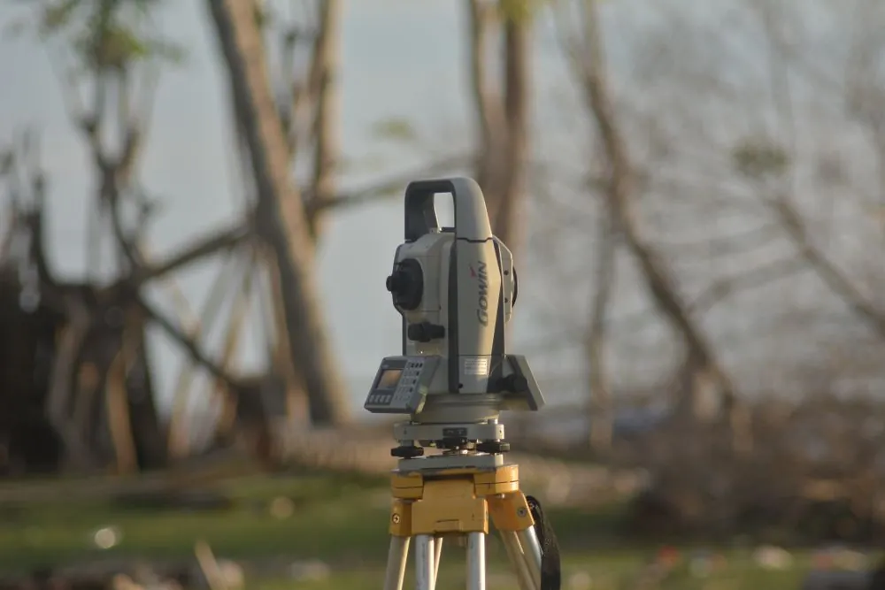
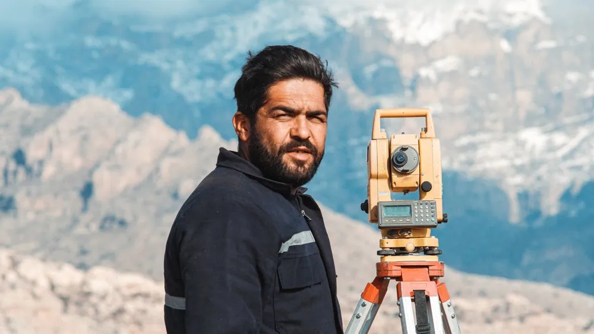
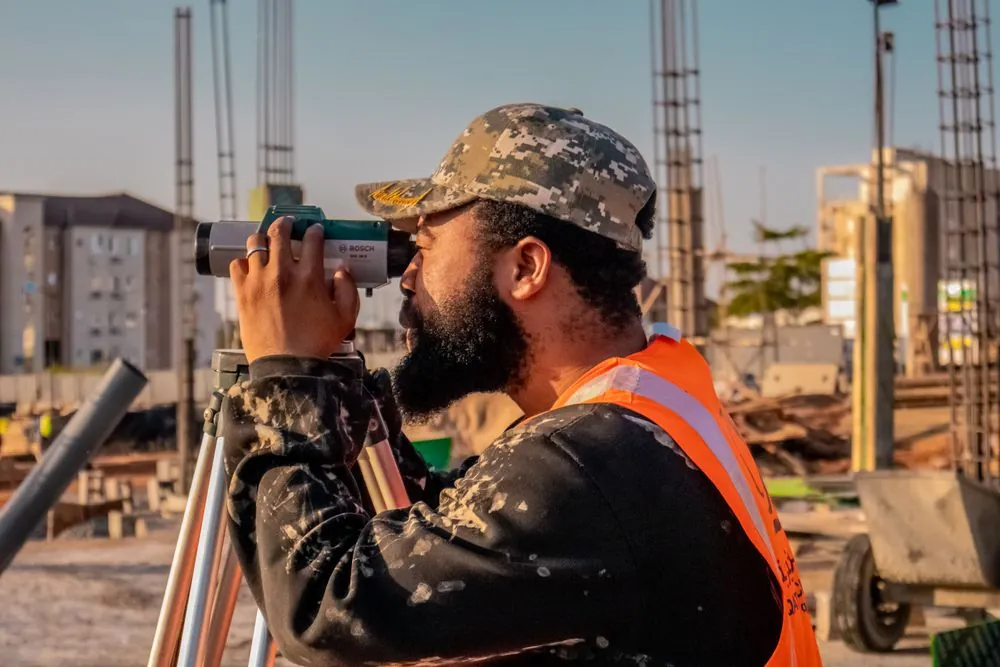
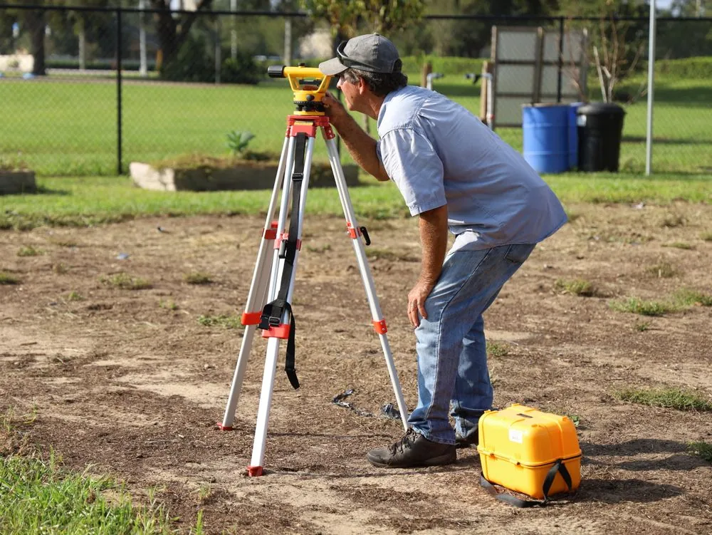

# TOP PASQUEL · Proyecto frontend

Landing corporativa de ingeniería topográfica y geomática, desarrollada con HTML5, CSS3 y JavaScript vanilla. El proyecto funciona sin instalaciones, compilación, frameworks ni bibliotecas de JavaScript.

## 1. Concepto visual y secciones

La identidad combina negro y amarillo seguridad con blanco y gris cálido. Una tipografía condensada en titulares, fotografías de campo, retículas e iconos técnicos comunican precisión y trabajo profesional. El diseño sigue una estrategia mobile first y amplía las columnas con CSS Grid cuando hay espacio suficiente.

La navegación conduce por portada, servicios, presentación de empresa, tecnología, aplicaciones de proyectos, cobertura, preguntas frecuentes y cotización. Se incluyen seis servicios y una carta de presentación en PDF. El isotipo es una propuesta gráfica editable en SVG, creada para este proyecto.

Las fotografías de stock se identifican como referenciales. Las tres aplicaciones del portafolio son casos ilustrativos y se pueden reemplazar por trabajos reales autorizados. No se incluyen testimonios, cifras comerciales, certificaciones ni clientes inventados.

## 2. Organización de carpetas

En el ZIP, la carpeta principal es `top-pasquel-frontend/`. Su contenido es:

| Ruta | Contenido |
| --- | --- |
| `index.html` | Estructura, contenido, SEO, formulario y diálogos |
| `css/styles.css` | Identidad visual, componentes, responsive y accesibilidad |
| `js/script.js` | Configuración de WhatsApp y cinco funcionalidades |
| `img/` | Fotografías WebP, logotipo SVG, mapa SVG e imagen social |
| `fonts/` | Fuentes locales y sus licencias OFL |
| `docs/carta-presentacion-top-pasquel.pdf` | Carta de presentación descargable |
| `GUIA_COMPLETA.md` | Desarrollo en siete pasos con los tres archivos completos |
| `README.md` | Instrucciones, personalización y pruebas |
| `CREDITOS.md` | Procedencia de las fotografías y recursos |
| `robots.txt` | Directivas básicas para buscadores |
| `sitemap.xml` | URL principal del sitio |

En el proyecto de alojamiento, los archivos de la web se encuentran en `dist/`. El ZIP ya los organiza en su raíz para abrirlos directamente en Visual Studio Code.

## 3. HTML completo


El archivo `index.html` contiene el HTML completo, sin fragmentos pendientes. Utiliza `header`, `nav`, `main`, `section`, `article`, `figure` y `footer`.

Solo hay un H1. Los títulos de sección usan H2 y los servicios usan H3. Incluye metadatos, canonical, Open Graph, tarjeta social, favicon y datos estructurados `ProfessionalService` con la información proporcionada de la empresa.

Las imágenes tienen dimensiones y textos alternativos. Las fotografías secundarias usan `loading="lazy"`; la portada tiene `fetchpriority="high"` y variantes `srcset`.


```html
<!DOCTYPE html>
<html lang="es-PE">
  <head>
    <meta charset="UTF-8">
    <meta name="viewport" content="width=device-width, initial-scale=1">
    <title>TOP PASQUEL | Topografía y Geomática en la Selva Central</title>
    <meta name="description" content="Servicios de topografía, GNSS RTK, geodesia, replanteo y fotogrametría con drone. TOP PASQUEL: base en Puerto Bermúdez y cobertura nacional. Solicita tu cotización.">
    <meta name="theme-color" content="#161914">
    <meta property="og:type" content="website">
    <meta property="og:locale" content="es_PE">
    <meta property="og:site_name" content="TOP PASQUEL">
    <meta property="og:title" content="TOP PASQUEL · Precisión que construye confianza">
    <meta property="og:description" content="Ingeniería topográfica y geomática. Del trabajo en campo a la información que tu proyecto necesita. Puerto Bermúdez · Cobertura nacional.">
    <meta property="og:url" content="https://top-pasquel-geomatic-2026.mellowhero8.chatgpt.site/">
    <meta property="og:image" content="https://top-pasquel-geomatic-2026.mellowhero8.chatgpt.site/img/social-top-pasquel.jpg">
    <meta property="og:image:alt" content="TOP PASQUEL: ingeniería topográfica y geomática">
    <meta name="twitter:card" content="summary_large_image">
    <link rel="canonical" href="https://top-pasquel-geomatic-2026.mellowhero8.chatgpt.site/">
    <link rel="icon" href="img/isotipo-top-pasquel.svg" type="image/svg+xml">
    <link rel="preload" href="fonts/barlow-condensed-bold.ttf" as="font" type="font/ttf" crossorigin>
    <link rel="stylesheet" href="css/styles.css">
    <script src="js/script.js" defer></script>
    <script type="application/ld+json">
  {
    "@context": "https://schema.org",
    "@type": "ProfessionalService",
    "name": "TOP PASQUEL",
    "description": "Ingeniería topográfica y geomática: levantamientos, GNSS RTK, geodesia, replanteo y fotogrametría.",
    "url": "https://top-pasquel-geomatic-2026.mellowhero8.chatgpt.site/",
    "image": "https://top-pasquel-geomatic-2026.mellowhero8.chatgpt.site/img/social-top-pasquel.jpg",
    "address": {
      "@type": "PostalAddress",
      "addressLocality": "Puerto Bermúdez",
      "addressRegion": "Pasco",
      "addressCountry": "PE"
    },
    "areaServed": {"@type": "Country", "name": "Perú"}
  }
  </script>
  </head>
  <body>
    <a class="skip-link" href="#contenido">Saltar al contenido</a>
    <!-- Los símbolos se reutilizan con <use>; no requieren una librería. -->
    <svg class="icon-library" xmlns="http://www.w3.org/2000/svg" aria-hidden="true">
      <symbol id="i-arrow" viewBox="0 0 24 24">
        <path d="M4 12h15m-6-6 6 6-6 6"></path>
      </symbol>
      <symbol id="i-north-east" viewBox="0 0 24 24">
        <path d="M6 18 18 6M6 6h12v12"></path>
      </symbol>
      <symbol id="i-pin" viewBox="0 0 24 24">
        <path d="M20 10c0 6-8 11-8 11S4 16 4 10a8 8 0 1 1 16 0Z"></path>
        <circle cx="12" cy="10" r="2.5"></circle>
      </symbol>
      <symbol id="i-target" viewBox="0 0 24 24">
        <circle cx="12" cy="12" r="7"></circle>
        <circle cx="12" cy="12" r="2"></circle>
        <path d="M12 1v5m0 12v5M1 12h5m12 0h5"></path>
      </symbol>
      <symbol id="i-grid" viewBox="0 0 24 24">
        <path d="m3 7 7-4 11 4v13l-11-4-7 4V7Zm7-4v13m11-9-11 4-7-4m7 4v10"></path>
      </symbol>
      <symbol id="i-station" viewBox="0 0 24 24">
        <rect x="7" y="3" width="10" height="11" rx="1"></rect>
        <circle cx="12" cy="7" r="2"></circle>
        <path d="M9 11h6M12 14v8m-2-8L4 22m10-8 6 8M5 3h2m10 0h2"></path>
      </symbol>
      <symbol id="i-satellite" viewBox="0 0 24 24">
        <path d="m8 3 5 5-5 5-5-5 5-5Zm3 8 4 4m-8 0-3 3m14-7-3 3m-4 4a4 4 0 0 0 4-4m-5 8a8 8 0 0 0 8-8M1 14l3 3m10-16 3 3"></path>
      </symbol>
      <symbol id="i-drone" viewBox="0 0 24 24">
        <rect x="8" y="8" width="8" height="8" rx="2"></rect>
        <path d="m8 8-4-4m12 4 4-4M8 16l-4 4m12-4 4 4M10 18h4"></path>
        <ellipse cx="4" cy="4" rx="3" ry="1.5"></ellipse>
        <ellipse cx="20" cy="4" rx="3" ry="1.5"></ellipse>
        <ellipse cx="4" cy="20" rx="3" ry="1.5"></ellipse>
        <ellipse cx="20" cy="20" rx="3" ry="1.5"></ellipse>
      </symbol>
      <symbol id="i-volume" viewBox="0 0 24 24">
        <path d="m12 2 9 5v10l-9 5-9-5V7l9-5Zm0 10 9-5M12 12 3 7m9 5v10M3 12l9 5 9-5"></path>
      </symbol>
      <symbol id="i-route" viewBox="0 0 24 24">
        <circle cx="5" cy="5" r="2"></circle>
        <circle cx="19" cy="19" r="2"></circle>
        <path d="M7 5h9a4 4 0 0 1 0 8H8a3 3 0 0 0 0 6h9"></path>
      </symbol>
      <symbol id="i-check" viewBox="0 0 24 24">
        <path d="m5 12 4 4L19 6"></path>
      </symbol>
      <symbol id="i-download" viewBox="0 0 24 24">
        <path d="M12 3v12m-5-5 5 5 5-5M4 16v5h16v-5"></path>
      </symbol>
      <symbol id="i-chat" viewBox="0 0 24 24">
        <path d="M21 11.5a9 9 0 0 1-13 8L3 21l1.5-5A9 9 0 1 1 21 11.5Z"></path>
        <path d="M8 7c0 5 4 9 8 9l1-3-3-1-1 1c-1.5-.5-2.5-1.5-3-3l1-1-1-3-2 1Z"></path>
      </symbol>
      <symbol id="i-close" viewBox="0 0 24 24">
        <path d="m6 6 12 12M6 18 18 6"></path>
      </symbol>
    </svg>
    <div class="topbar">
      <div class="container topbar-inner">
        <span>
          <span class="status-dot"></span> BASE EN PUERTO BERMÚDEZ, PASCO</span>
        <span>SELVA CENTRAL <span class="topbar-divider">/</span> COBERTURA NACIONAL</span>
      </div>
    </div>
    <header class="site-header">
      <div class="container header-inner">
        <a class="brand" href="#inicio" aria-label="TOP PASQUEL, inicio">
          
          <span>
            <strong>TOP PASQUEL<span class="brand-dot">.</span>
            </strong>
            <small>INGENIERÍA TOPOGRÁFICA &amp; GEOMÁTICA</small>
          </span>
        </a>
        <button class="menu-toggle" type="button" aria-expanded="false" aria-controls="menu-principal" aria-label="Abrir menú">
          <span></span>
          <span></span>
          <span></span>
        </button>
        <nav class="main-nav" id="menu-principal" aria-label="Navegación principal">
          <a href="#nosotros">Nosotros</a>
          <a href="#servicios">Servicios</a>
          <a href="#equipos">Tecnología</a>
          <a href="#proyectos">Proyectos</a>
          <a class="button button-small" href="#contacto">Cotizar proyecto <svg class="icon" aria-hidden="true">
              <use href="#i-north-east"></use>
            </svg>
          </a>
        </nav>
      </div>
    </header>
    <main id="contenido">
      <section class="hero" id="inicio" aria-labelledby="titulo-principal">
        
        <div class="hero-shade"></div>
        <div class="hero-grid" aria-hidden="true"></div>
        <div class="container hero-content">
          <p class="eyebrow light">
            <span></span> TU PROYECTO EMPIEZA CON PRECISIÓN</p>
          <h1 id="titulo-principal">MEDIMOS EL TERRENO.<br>
            <span>PROYECTAMOS</span>
            <br>CONFIANZA.</h1>
          <p class="hero-description">Ingeniería topográfica y geomática para llevar tu proyecto del primer punto al siguiente nivel.</p>
          <div class="hero-actions">
            <a class="button" href="#contacto">Solicitar cotización <svg class="icon" aria-hidden="true">
                <use href="#i-north-east"></use>
              </svg>
            </a>
            <a class="hero-secondary" href="#servicios">Explorar servicios <svg class="icon" aria-hidden="true">
                <use href="#i-arrow"></use>
              </svg>
            </a>
          </div>
          <div class="hero-location">
            <svg class="icon" aria-hidden="true">
              <use href="#i-pin"></use>
            </svg> Desde Puerto Bermúdez, para todo el Perú.</div>
        </div>
        <div class="hero-footnote">
          <span>01 / TRABAJO DE CAMPO</span>
          <span>FOTOGRAFÍA REFERENCIAL</span>
        </div>
        <div class="hero-crosshair" aria-hidden="true">
          <span>+</span>
        </div>
      </section>
      <div class="value-strip">
        <div class="container value-grid">
          <div>
            <svg class="icon" aria-hidden="true">
              <use href="#i-target"></use>
            </svg>
            <span>Precisión en cada punto<small>Datos que respaldan tus decisiones</small>
            </span>
          </div>
          <div>
            <svg class="icon" aria-hidden="true">
              <use href="#i-satellite"></use>
            </svg>
            <span>Tecnología aplicada al terreno<small>Estación Total · GNSS RTK · Drone</small>
            </span>
          </div>
          <div>
            <svg class="icon" aria-hidden="true">
              <use href="#i-route"></use>
            </svg>
            <span>Compromiso con tu proyecto<small>Del levantamiento a la entrega técnica</small>
            </span>
          </div>
        </div>
      </div>
      <section class="section services" id="servicios" aria-labelledby="titulo-servicios">
        <div class="container">
          <div class="section-heading">
            <div>
              <p class="eyebrow">01 / NUESTROS SERVICIOS</p>
              <h2 id="titulo-servicios">UNA BASE EXACTA.<br>GRANDES POSIBILIDADES.</h2>
            </div>
            <p>Información del terreno para diseñar, construir y avanzar con seguridad. Soluciones técnicas a la medida de cada etapa de tu proyecto.</p>
          </div>
          <div class="services-grid">
            <article class="service-card">
              <div class="service-top">
                <svg class="service-icon" aria-hidden="true">
                  <use href="#i-station"></use>
                </svg>
                <span>01</span>
              </div>
              <h3>Levantamientos topográficos</h3>
              <p>Medición planimétrica y altimétrica con Estación Total y GNSS Diferencial RTK. Una lectura detallada de tu terreno.</p>
              <a href="#contacto" data-service="Levantamiento topográfico">Cotizar servicio <svg class="icon" aria-hidden="true">
                  <use href="#i-north-east"></use>
                </svg>
              </a>
            </article>
            <article class="service-card">
              <div class="service-top">
                <svg class="service-icon" aria-hidden="true">
                  <use href="#i-satellite"></use>
                </svg>
                <span>02</span>
              </div>
              <h3>Geodesia y GNSS RTK</h3>
              <p>Posicionamiento y puntos de control georreferenciados para vincular el trabajo de campo con el sistema de referencia del proyecto.</p>
              <a href="#contacto" data-service="Geodesia y GNSS RTK">Cotizar servicio <svg class="icon" aria-hidden="true">
                  <use href="#i-north-east"></use>
                </svg>
              </a>
            </article>
            <article class="service-card">
              <div class="service-top">
                <svg class="service-icon" aria-hidden="true">
                  <use href="#i-drone"></use>
                </svg>
                <span>03</span>
              </div>
              <h3>Fotogrametría con drone</h3>
              <p>Vuelos RPA para obtener ortofotos y modelos del terreno. Una perspectiva completa para analizar y planificar.</p>
              <a href="#contacto" data-service="Fotogrametría con drone">Cotizar servicio <svg class="icon" aria-hidden="true">
                  <use href="#i-north-east"></use>
                </svg>
              </a>
            </article>
            <article class="service-card">
              <div class="service-top">
                <svg class="service-icon" aria-hidden="true">
                  <use href="#i-target"></use>
                </svg>
                <span>04</span>
              </div>
              <h3>Replanteo y control de obras</h3>
              <p>Traslado de ejes, niveles y puntos de diseño al terreno. Acompañamiento topográfico durante la ejecución de obras civiles.</p>
              <a href="#contacto" data-service="Replanteo y control de obras">Cotizar servicio <svg class="icon" aria-hidden="true">
                  <use href="#i-north-east"></use>
                </svg>
              </a>
            </article>
            <article class="service-card">
              <div class="service-top">
                <svg class="service-icon" aria-hidden="true">
                  <use href="#i-grid"></use>
                </svg>
                <span>05</span>
              </div>
              <h3>Lotizaciones y habilitaciones</h3>
              <p>Base topográfica, delimitación y organización de lotes para la planificación técnica de proyectos urbanos.</p>
              <a href="#contacto" data-service="Lotizaciones y habilitaciones urbanas">Cotizar servicio <svg class="icon" aria-hidden="true">
                  <use href="#i-north-east"></use>
                </svg>
              </a>
            </article>
            <article class="service-card">
              <div class="service-top">
                <svg class="service-icon" aria-hidden="true">
                  <use href="#i-volume"></use>
                </svg>
                <span>06</span>
              </div>
              <h3>Volúmenes y movimiento de tierras</h3>
              <p>Modelado de superficies, cálculo de corte y relleno y seguimiento de volúmenes para la gestión de tu obra.</p>
              <a href="#contacto" data-service="Volúmenes y movimiento de tierras">Cotizar servicio <svg class="icon" aria-hidden="true">
                  <use href="#i-north-east"></use>
                </svg>
              </a>
            </article>
          </div>
        </div>
      </section>
      <section class="section about" id="nosotros" aria-labelledby="titulo-nosotros">
        <div class="container about-grid">
          <div class="about-visual">
            
            <div class="about-label">
              <svg class="icon" aria-hidden="true">
                <use href="#i-target"></use>
              </svg>
              <span>EXPERIENCIA EN CAMPO.<br>VISIÓN EN CADA PROYECTO.</span>
            </div>
            <span class="image-caption">Imagen referencial de equipo topográfico</span>
          </div>
          <div class="about-copy">
            <p class="eyebrow">02 / SOMOS TOP PASQUEL</p>
            <h2 id="titulo-nosotros">EL PRIMER PASO<br>ES CONOCER<br>
              <span class="text-outline">EL TERRENO.</span>
            </h2>
            <p>Somos una empresa de ingeniería topográfica y geomática con base en Puerto Bermúdez, en el corazón de la Selva Central.</p>
            <p>Combinamos tecnología de medición con experiencia en campo para transformar el terreno en información exacta, útil y confiable para constructoras, municipalidades, ingenieros, arquitectos y propietarios.</p>
            <ul class="check-list">
              <li>
                <svg class="icon" aria-hidden="true">
                  <use href="#i-check"></use>
                </svg> Enfoque técnico para cada tipo de proyecto</li>
              <li>
                <svg class="icon" aria-hidden="true">
                  <use href="#i-check"></use>
                </svg> Trabajo coordinado de campo y gabinete</li>
              <li>
                <svg class="icon" aria-hidden="true">
                  <use href="#i-check"></use>
                </svg> Entregables definidos desde el inicio</li>
            </ul>
            <a class="text-link" href="docs/carta-presentacion-top-pasquel.pdf" download>Descargar carta de presentación <svg class="icon" aria-hidden="true">
                <use href="#i-download"></use>
              </svg>
            </a>
          </div>
        </div>
      </section>
      <section class="section technology" id="equipos" aria-labelledby="titulo-equipos">
        <div class="contours" aria-hidden="true"></div>
        <div class="container">
          <div class="section-heading">
            <div>
              <p class="eyebrow">03 / TECNOLOGÍA QUE HACE LA DIFERENCIA</p>
              <h2 id="titulo-equipos">HERRAMIENTAS PRECISAS.<br>DECISIONES CON FUNDAMENTO.</h2>
            </div>
            <p>Seleccionamos la metodología y el equipo según el alcance, las condiciones del terreno y la precisión que exige tu proyecto.</p>
          </div>
          <div class="equipment-grid">
            <article class="equipment-card">
              <span class="tech-tag">MEDICIÓN TERRESTRE</span>
              <div class="equipment-illustration">
                <svg aria-hidden="true">
                  <use href="#i-station"></use>
                </svg>
                <span class="equipment-cross">+</span>
              </div>
              <h3>Estación Total</h3>
              <p>Ángulos, distancias, ejes y niveles para levantamientos y replanteos de obra.</p>
              <span class="equipment-bottom">CONTROL EN CADA PUNTO <span>01</span>
              </span>
            </article>
            <article class="equipment-card">
              <span class="tech-tag">POSICIONAMIENTO SATELITAL</span>
              <div class="equipment-illustration">
                <svg aria-hidden="true">
                  <use href="#i-satellite"></use>
                </svg>
                <span class="equipment-cross">+</span>
              </div>
              <h3>GNSS Diferencial RTK</h3>
              <p>Coordenadas y georreferenciación con correcciones en tiempo real.</p>
              <span class="equipment-bottom">CONEXIÓN CON EL TERRITORIO <span>02</span>
              </span>
            </article>
            <article class="equipment-card">
              <span class="tech-tag">CAPTURA AÉREA</span>
              <div class="equipment-illustration">
                <svg aria-hidden="true">
                  <use href="#i-drone"></use>
                </svg>
                <span class="equipment-cross">+</span>
              </div>
              <h3>Drone RPA</h3>
              <p>Fotogrametría y registro aéreo para interpretar superficies y extensiones.</p>
              <span class="equipment-bottom">UNA PERSPECTIVA COMPLETA <span>03</span>
              </span>
            </article>
          </div>
        </div>
      </section>
      <section class="section projects" id="proyectos" aria-labelledby="titulo-proyectos">
        <div class="container">
          <div class="section-heading">
            <div>
              <p class="eyebrow">04 / PROYECTOS Y APLICACIONES</p>
              <h2 id="titulo-proyectos">DEL DATO DE CAMPO<br>A LA SOLUCIÓN TÉCNICA.</h2>
            </div>
            <p>Explora cómo aplicamos la topografía en diferentes necesidades. Casos ilustrativos e imágenes referenciales de cada servicio.</p>
          </div>
          <div class="project-filters" role="group" aria-label="Filtrar aplicaciones por categoría">
            <button class="filter-button is-active" data-filter="todos" aria-pressed="true">Todos <span>03</span>
            </button>
            <button class="filter-button" data-filter="topografia" aria-pressed="false">Topografía</button>
            <button class="filter-button" data-filter="obras" aria-pressed="false">Obras civiles</button>
            <button class="filter-button" data-filter="territorio" aria-pressed="false">Territorio</button>
          </div>
          <p class="sr-only" id="filter-status" role="status">3 aplicaciones disponibles.</p>
          <div class="projects-grid">
            <article class="project-card" data-category="topografia">
              <button type="button" class="project-open" data-project="levantamiento" aria-label="Ver aplicación: levantamiento para diseño">
                <span class="project-image">
                  
                  <span class="project-category">TOPOGRAFÍA</span>
                  <span class="project-arrow">
                    <svg class="icon" aria-hidden="true">
                      <use href="#i-north-east"></use>
                    </svg>
                  </span>
                </span>
                <span class="project-copy">
                  <small>PLANIFICACIÓN · DISEÑO</small>
                  <strong>Levantamiento del terreno</strong>
                  <span>Una base técnica para el inicio de tu proyecto.</span>
                </span>
              </button>
            </article>
            <article class="project-card" data-category="obras">
              <button type="button" class="project-open" data-project="replanteo" aria-label="Ver aplicación: replanteo y control de obra">
                <span class="project-image">
                  
                  <span class="project-category">OBRAS CIVILES</span>
                  <span class="project-arrow">
                    <svg class="icon" aria-hidden="true">
                      <use href="#i-north-east"></use>
                    </svg>
                  </span>
                </span>
                <span class="project-copy">
                  <small>EJES · NIVELES · CONTROL</small>
                  <strong>Del plano a la obra</strong>
                  <span>El diseño llevado al terreno con precisión.</span>
                </span>
              </button>
            </article>
            <article class="project-card" data-category="territorio">
              <button type="button" class="project-open" data-project="lotizacion" aria-label="Ver aplicación: planificación de lotizaciones">
                <span class="project-image">
                  
                  <span class="project-category">TERRITORIO</span>
                  <span class="project-arrow">
                    <svg class="icon" aria-hidden="true">
                      <use href="#i-north-east"></use>
                    </svg>
                  </span>
                </span>
                <span class="project-copy">
                  <small>DELIMITACIÓN · DESARROLLO URBANO</small>
                  <strong>Terrenos con proyección</strong>
                  <span>Información para organizar y planificar lotes.</span>
                </span>
              </button>
            </article>
          </div>
        </div>
      </section>
      <section class="coverage" id="cobertura" aria-labelledby="titulo-cobertura">
        <div class="container coverage-grid">
          <div class="coverage-copy">
            <p class="eyebrow">05 / NUESTRA COBERTURA</p>
            <h2 id="titulo-cobertura">CONOCEMOS LA SELVA.<br>LLEGAMOS MÁS LEJOS.</h2>
            <p>Nuestra base está en Puerto Bermúdez, Pasco. Atendemos proyectos en la Selva Central y coordinamos servicios en todo el Perú.</p>
            <div class="location-card">
              <svg class="icon" aria-hidden="true">
                <use href="#i-pin"></use>
              </svg>
              <div>
                <strong>Puerto Bermúdez</strong>
                <span>Oxapampa · Pasco · Perú</span>
              </div>
              <span class="base-tag">BASE OPERATIVA</span>
            </div>
            <a class="text-link" href="https://www.google.com/maps/search/?api=1&amp;query=Puerto+Berm%C3%BAdez+Pasco+Per%C3%BA" target="_blank" rel="noopener noreferrer">Ver ubicación en Google Maps <svg class="icon" aria-hidden="true">
                <use href="#i-north-east"></use>
              </svg>
            </a>
          </div>
          <figure class="coverage-map">
            
            <figcaption>Mapa de cobertura esquemático. Ubicación referencial.</figcaption>
          </figure>
        </div>
      </section>
      <section class="section faq" aria-labelledby="titulo-preguntas">
        <div class="container faq-grid">
          <div>
            <p class="eyebrow">RESOLVEMOS TUS DUDAS</p>
            <h2 id="titulo-preguntas">ANTES DEL<br>PRIMER PUNTO.</h2>
            <p>Todo empieza por entender lo que tu proyecto necesita.</p>
          </div>
          <div class="faq-list">
            <details>
              <summary>¿Qué necesito para solicitar una cotización?</summary>
              <p>Indícanos la ubicación, el tipo de servicio, el área aproximada y el objetivo del trabajo. Si tienes planos o referencias del terreno, puedes compartirlos al coordinar la atención.</p>
            </details>
            <details>
              <summary>¿Atienden fuera de Puerto Bermúdez?</summary>
              <p>Sí. Nuestra base está en Puerto Bermúdez y atendemos la Selva Central. También coordinamos trabajos a nivel nacional, definiendo previamente el alcance, acceso y logística.</p>
            </details>
            <details>
              <summary>¿Qué documentos recibiré al finalizar?</summary>
              <p>Los entregables se acuerdan según el servicio: planos, listado de coordenadas, curvas de nivel, modelos de terreno, ortofotos o informes técnicos, en los formatos definidos en la propuesta.</p>
            </details>
            <details>
              <summary>¿Cuánto demora un levantamiento topográfico?</summary>
              <p>El plazo depende del área, la accesibilidad, la cobertura vegetal, las condiciones de trabajo y el detalle requerido. La propuesta establece el cronograma de campo y gabinete.</p>
            </details>
          </div>
        </div>
      </section>
      <section class="section contact" id="contacto" aria-labelledby="titulo-contacto">
        <div class="container contact-grid">
          <div class="contact-copy">
            <p class="eyebrow">06 / CONVERSEMOS DE TU PROYECTO</p>
            <h2 id="titulo-contacto">TU PRÓXIMO<br>PROYECTO,<br>
              <span>BIEN MEDIDO.</span>
            </h2>
            <p>Cuéntanos qué necesitas. Prepara una solicitud con los datos de tu terreno y da el primer paso.</p>
            <div class="contact-detail">
              <svg class="icon" aria-hidden="true">
                <use href="#i-pin"></use>
              </svg>
              <span>Puerto Bermúdez, Pasco<br>
                <small>Selva Central · Cobertura nacional</small>
              </span>
            </div>
            <a href="docs/carta-presentacion-top-pasquel.pdf" download class="brochure-link">
              <svg class="icon" aria-hidden="true">
                <use href="#i-download"></use>
              </svg> Carta de presentación <span>PDF</span>
            </a>
          </div>
          <form class="quote-form" id="quote-form" novalidate>
            <div class="form-heading">
              <h3>Solicita tu cotización</h3>
              <p>Los campos con * son obligatorios.</p>
            </div>
            <div class="form-row">
              <div class="form-field">
                <label for="nombre">Nombre completo *</label>
                <input id="nombre" name="nombre" autocomplete="name" required minlength="2" maxlength="100" placeholder="Tu nombre y apellido" aria-describedby="error-nombre">
                <small class="field-error" id="error-nombre"></small>
              </div>
              <div class="form-field">
                <label for="empresa">Empresa <span>(opcional)</span>
                </label>
                <input id="empresa" name="empresa" autocomplete="organization" maxlength="100" placeholder="Empresa o institución">
              </div>
            </div>
            <div class="form-row">
              <div class="form-field">
                <label for="telefono">Teléfono / WhatsApp *</label>
                <input id="telefono" name="telefono" type="tel" inputmode="tel" autocomplete="tel" required maxlength="25" placeholder="Ej. 987 654 321" aria-describedby="error-telefono">
                <small class="field-error" id="error-telefono"></small>
              </div>
              <div class="form-field">
                <label for="correo">Correo electrónico <span>(opcional)</span>
                </label>
                <input id="correo" name="correo" type="email" autocomplete="email" maxlength="150" placeholder="tu@correo.com" aria-describedby="error-correo">
                <small class="field-error" id="error-correo"></small>
              </div>
            </div>
            <div class="form-field">
              <label for="servicio">Servicio que necesitas *</label>
              <select id="servicio" name="servicio" required aria-describedby="error-servicio">
                <option value="">Selecciona un servicio</option>
                <option>Levantamiento topográfico</option>
                <option>Geodesia y GNSS RTK</option>
                <option>Fotogrametría con drone</option>
                <option>Replanteo y control de obras</option>
                <option>Lotizaciones y habilitaciones urbanas</option>
                <option>Volúmenes y movimiento de tierras</option>
                <option>Asesoría para mi proyecto</option>
              </select>
              <small class="field-error" id="error-servicio"></small>
            </div>
            <div class="form-field">
              <label for="ubicacion">Ubicación del proyecto *</label>
              <input id="ubicacion" name="ubicacion" required minlength="3" maxlength="180" placeholder="Distrito, provincia y departamento" aria-describedby="error-ubicacion">
              <small class="field-error" id="error-ubicacion"></small>
            </div>
            <div class="form-field">
              <label for="detalle">Cuéntanos un poco más <span>(opcional)</span>
              </label>
              <textarea id="detalle" name="detalle" rows="3" maxlength="1200" placeholder="Área aproximada, objetivo del trabajo y fecha estimada..."></textarea>
            </div>
            <div class="form-consent">
              <input id="consentimiento" name="consentimiento" type="checkbox" required aria-describedby="error-consentimiento">
              <label for="consentimiento">Autorizo compartir estos datos para solicitar atención sobre mi proyecto. *</label>
            </div>
            <small class="field-error" id="error-consentimiento"></small>
            <button class="button form-submit" type="submit">Preparar solicitud <svg class="icon" aria-hidden="true">
                <use href="#i-arrow"></use>
              </svg>
            </button>
            <p class="form-note">Revisa tu mensaje antes de compartirlo por WhatsApp. Este formulario no realiza envíos automáticos.</p>
            <p class="form-status" id="form-status" role="status" aria-live="polite"></p>
            <noscript>
              <p>Activa JavaScript para preparar la solicitud y compartirla por WhatsApp.</p>
            </noscript>
          </form>
        </div>
      </section>
    </main>
    <footer class="site-footer">
      <div class="container footer-top">
        <a class="brand brand-footer" href="#inicio" aria-label="TOP PASQUEL, volver al inicio">
          
          <span>
            <strong>TOP PASQUEL<span class="brand-dot">.</span>
            </strong>
            <small>INGENIERÍA TOPOGRÁFICA &amp; GEOMÁTICA</small>
          </span>
        </a>
        <p>Precisión que construye confianza.</p>
        <a href="#inicio" class="back-top">Volver arriba <span>↑</span>
        </a>
      </div>
      <div class="container footer-bottom">
        <p>© <span id="current-year">2026</span> TOP PASQUEL. Todos los derechos reservados.</p>
        <nav aria-label="Enlaces del pie de página">
          <a href="#servicios">Servicios</a>
          <a href="#cobertura">Cobertura</a>
          <a href="#contacto">Contacto</a>
        </nav>
        <span>PUERTO BERMÚDEZ · PERÚ</span>
      </div>
    </footer>
    <a class="whatsapp-float" id="whatsapp-link" href="#contacto" aria-label="Solicitar cotización por WhatsApp">
      <svg class="icon" aria-hidden="true">
        <use href="#i-chat"></use>
      </svg>
      <span>Cotiza por WhatsApp</span>
    </a>
    <!-- <dialog> ofrece foco modal y cierre con Escape de forma nativa. -->
    <dialog class="project-dialog" id="project-dialog" aria-labelledby="dialog-title">
      <button type="button" class="dialog-close" data-close-dialog aria-label="Cerrar detalle">
        <svg class="icon" aria-hidden="true">
          <use href="#i-close"></use>
        </svg>
      </button>
      
      <div class="dialog-content">
        <p class="eyebrow" id="dialog-category"></p>
        <h2 id="dialog-title">Detalle de aplicación</h2>
        <p id="dialog-description"></p>
        <h3>Entregables según el alcance</h3>
        <ul id="dialog-deliverables"></ul>
        <p class="reference-note">Caso ilustrativo de servicio. La fotografía es referencial.</p>
        <a class="button" href="#contacto" id="dialog-quote">Cotizar este servicio <svg class="icon" aria-hidden="true">
            <use href="#i-north-east"></use>
          </svg>
        </a>
      </div>
    </dialog>
    <dialog class="quote-dialog" id="quote-dialog" aria-labelledby="quote-dialog-title">
      <button type="button" class="dialog-close" data-close-dialog aria-label="Cerrar solicitud">
        <svg class="icon" aria-hidden="true">
          <use href="#i-close"></use>
        </svg>
      </button>
      <div class="dialog-content">
        <p class="eyebrow">EL PRIMER PASO ESTÁ LISTO</p>
        <h2 id="quote-dialog-title">REVISA TU SOLICITUD.</h2>
        <p>Comprueba los datos antes de compartirlos.</p>
        <pre id="quote-preview" class="quote-preview" tabindex="0" aria-label="Vista previa de tu solicitud"></pre>
        <p id="whatsapp-note" class="reference-note"></p>
        <div class="quote-actions">
          <a class="button" id="send-whatsapp" href="https://api.whatsapp.com/send" target="_blank" rel="noopener noreferrer">Compartir por WhatsApp <svg class="icon" aria-hidden="true">
              <use href="#i-chat"></use>
            </svg>
          </a>
          <button class="button button-outline" type="button" id="download-request">Descargar solicitud</button>
        </div>
        <p class="form-note">Se abrirá WhatsApp; tú decides cuándo enviar el mensaje.</p>
      </div>
    </dialog>
  </body>
</html>
```

## 4. CSS completo y responsive


`css/styles.css` contiene el CSS completo. Se organiza por secciones comentadas. Las variables de `:root` controlan colores, fuentes, ancho de contenido y espaciados.

La base es móvil. A partir de `40rem` se incorporan columnas de tableta; desde `64rem` aparece la navegación de escritorio y las cuadrículas de tres columnas. Flexbox organiza botones y navegación; Grid distribuye servicios, equipos y secciones.

El sitio incluye estados `hover`, foco de teclado visible, imágenes fluidas y reglas `prefers-reduced-motion`. Las fuentes están incluidas localmente: no se consulta Google Fonts durante la navegación.


```css
/* 1. Fuentes locales y variables: cambia aquí la identidad del sitio. */
@font-face {
  font-family: "Manrope";
  src: url("../fonts/manrope-regular.ttf") format("truetype");
  font-style: normal;
  font-weight: 400;
  font-display: swap;
}

@font-face {
  font-family: "Manrope";
  src: url("../fonts/manrope-bold.ttf") format("truetype");
  font-style: normal;
  font-weight: 700;
  font-display: swap;
}

@font-face {
  font-family: "Barlow Condensed";
  src: url("../fonts/barlow-condensed-bold.ttf") format("truetype");
  font-style: normal;
  font-weight: 700;
  font-display: swap;
}

:root {
  --yellow: #f8cc18;
  --yellow-hover: #ffdc4c;
  --ink: #161914;
  --dark: #1d211c;
  --paper: #ffffff;
  --surface: #f4f5f0;
  --muted: #656b61;
  --line: #dfe2d9;
  --error: #a32924;
  --font-body: "Manrope", Arial, sans-serif;
  --font-display: "Barlow Condensed", "Arial Narrow", Impact, sans-serif;
  --container: 76rem;
  --section-space: clamp(4rem, 7vw, 6.5rem);
  --radius: 0.2rem;
}


/* 2. Base accesible. La composición comienza en móvil. */
*, *::before, *::after {
  box-sizing: border-box;
}

html {
  scroll-behavior: smooth;
  scroll-padding-top: 6rem;
}

body {
  margin: 0;
  color: var(--ink);
  background: var(--paper);
  font-family: var(--font-body);
  font-size: 0.9375rem;
  line-height: 1.75;
}

body.dialog-open {
  overflow: hidden;
}

img {
  display: block;
  max-width: 100%;
  height: auto;
}

svg {
  flex-shrink: 0;
}

a {
  color: inherit;
  text-decoration: none;
}

button, input, select, textarea {
  font: inherit;
}

button, a, input, select, textarea, summary {
  -webkit-tap-highlight-color: transparent;
}

button {
  color: inherit;
  cursor: pointer;
}

button, input, select, textarea {
  border-radius: var(--radius);
}

button {
  border: 0;
}

button:disabled {
  cursor: default;
}

input, select, textarea {
  min-width: 0;
}

textarea {
  resize: vertical;
}

h1, h2, h3, p, figure {
  margin: 0;
}

h1, h2 {
  font-family: var(--font-display);
  font-weight: 700;
  line-height: 1.04;
  letter-spacing: -0.012em;
}

h2 {
  font-size: clamp(2.35rem, 5vw, 3.5rem);
}

h3 {
  line-height: 1.35;
  font-weight: 700;
}

ul {
  padding: 0;
  margin: 0;
  list-style: none;
}

::selection {
  background: var(--yellow);
  color: var(--ink);
}

:focus-visible {
  outline: 3px solid #3065bb;
  outline-offset: 5px;
}

[hidden] {
  display: none !important;
}

.container {
  width: min(calc(100% - 2.5rem), var(--container));
  margin-inline: auto;
}

.section {
  padding-block: var(--section-space);
}

.icon {
  width: 1.35rem;
  height: 1.35rem;
  fill: none;
  stroke: currentColor;
  stroke-width: 1.7;
  stroke-linecap: round;
  stroke-linejoin: round;
}

.icon-library {
  position: absolute;
  width: 0;
  height: 0;
  overflow: hidden;
}

.sr-only {
  position: absolute;
  width: 1px;
  height: 1px;
  padding: 0;
  margin: -1px;
  overflow: hidden;
  clip-path: inset(50%);
  white-space: nowrap;
  border: 0;
}

.skip-link {
  position: fixed;
  z-index: 100;
  top: 0.5rem;
  left: 1rem;
  transform: translateY(-200%);
  background: var(--yellow);
  padding: 0.7rem 1rem;
  font-weight: 700;
}

.skip-link:focus {
  transform: translateY(0);
}

.eyebrow {
  display: flex;
  align-items: center;
  gap: 0.65rem;
  margin-bottom: 1.25rem;
  font-size: 0.67rem;
  line-height: 1.5;
  letter-spacing: 0.13em;
  font-weight: 700;
}

.eyebrow::before {
  content: "";
  width: 1.6rem;
  height: 2px;
  background: var(--yellow);
  flex-shrink: 0;
}

.button {
  display: inline-flex;
  min-height: 3.4rem;
  align-items: center;
  justify-content: center;
  gap: 1.7rem;
  padding: 0.85rem 1.3rem;
  background: var(--yellow);
  color: var(--ink);
  font-size: 0.82rem;
  font-weight: 700;
  line-height: 1.5;
  transition: background 180ms, transform 180ms;
  border: 1px solid transparent;
  border-radius: var(--radius);
}

.button:hover {
  background: var(--yellow-hover);
  transform: translateY(-2px);
}

.button .icon {
  width: 1.2rem;
  height: 1.2rem;
}

.button-small {
  min-height: 2.8rem;
  padding: 0.65rem 1rem;
  gap: 1.1rem;
}

.button-outline {
  background: transparent;
  border-color: var(--line);
}

.button-outline:hover {
  background: var(--surface);
}

.text-link {
  display: inline-flex;
  align-items: center;
  gap: 1rem;
  padding-block: 0.7rem;
  border-bottom: 1px solid var(--ink);
  font-size: 0.82rem;
  font-weight: 700;
}

.text-link:hover {
  border-color: var(--yellow);
}

.section-heading {
  display: grid;
  gap: 1.5rem;
  margin-bottom: 2.5rem;
}

.section-heading > p {
  color: var(--muted);
  max-width: 28rem;
  font-size: 0.88rem;
}


/* 3. Encabezado y navegación. El menú funciona sin JS como lista visible. */
.topbar {
  background: var(--ink);
  color: #d4d9cd;
  font-size: 0.56rem;
  letter-spacing: 0.1em;
}

.topbar-inner {
  display: flex;
  align-items: center;
  justify-content: space-between;
  gap: 1rem;
  min-height: 1.9rem;
}

.topbar-inner > span {
  display: inline-flex;
  align-items: center;
  gap: 0.5rem;
}

.topbar-inner > span:last-child {
  display: none;
}

.status-dot {
  width: 0.35rem;
  height: 0.35rem;
  border-radius: 50%;
  background: var(--yellow);
}

.topbar-divider {
  color: #72796e;
  margin-inline: 0.5rem;
}

.site-header {
  position: sticky;
  top: 0;
  z-index: 30;
  background: var(--paper);
  border-bottom: 1px solid #eeeeea;
}

.header-inner {
  min-height: 5rem;
  display: flex;
  align-items: center;
  justify-content: space-between;
  flex-wrap: wrap;
  gap: 1rem;
  padding-block: 0.9rem;
}

.brand {
  display: inline-flex;
  gap: 0.65rem;
  align-items: center;
  flex-shrink: 0;
}

.brand img {
  width: 2.5rem;
  height: 2.5rem;
}

.brand strong {
  display: block;
  font-family: var(--font-display);
  font-size: 1.8rem;
  line-height: 1;
  letter-spacing: 0.015em;
}

.brand-dot {
  color: #b58b00;
}

.brand small {
  display: block;
  margin-top: 0.35rem;
  font-size: 0.43rem;
  line-height: 1.3;
  font-weight: 700;
  letter-spacing: 0.08em;
}

.menu-toggle {
  display: none;
  width: 2.8rem;
  height: 2.8rem;
  background: var(--surface);
  padding: 0.75rem;
}

.menu-toggle span {
  display: block;
  height: 2px;
  background: var(--ink);
  margin: 4px 0;
  transition: transform 180ms, opacity 180ms;
}

.menu-toggle[aria-expanded="true"] span:nth-child(1) {
  transform: translateY(6px) rotate(45deg);
}

.menu-toggle[aria-expanded="true"] span:nth-child(2) {
  opacity: 0;
}

.menu-toggle[aria-expanded="true"] span:nth-child(3) {
  transform: translateY(-6px) rotate(-45deg);
}

.main-nav {
  display: flex;
  width: 100%;
  flex-wrap: wrap;
  align-items: center;
  gap: 0.5rem 1rem;
  font-size: 0.8rem;
  font-weight: 700;
}

.main-nav > a:not(.button) {
  display: block;
  padding: 0.6rem 0;
}

.main-nav > a:not(.button):hover {
  color: #7b6100;
}

.js .menu-toggle {
  display: block;
}

.js .main-nav {
  display: none;
  padding: 1rem 0 0.4rem;
  border-top: 1px solid var(--line);
}

.js .main-nav.is-open {
  display: flex;
  flex-direction: column;
  align-items: stretch;
}


/* 4. Portada fotográfica. La capa izquierda asegura contraste. */
.hero {
  position: relative;
  isolation: isolate;
  overflow: hidden;
  color: var(--paper);
  background: var(--ink);
}

.hero-image, .hero-shade, .hero-grid {
  position: absolute;
  inset: 0;
  width: 100%;
  height: 100%;
}

.hero-image {
  object-fit: cover;
  object-position: 65% center;
  z-index: -3;
}

.hero-shade {
  z-index: -2;
  background: linear-gradient(90deg, rgba(15,20,14,.94), rgba(15,20,14,.74) 45%, rgba(15,20,14,.22));
}

.hero-grid {
  z-index: -1;
  opacity: 0.08;
  background-image: linear-gradient(#fff 1px, transparent 1px), linear-gradient(90deg, #fff 1px, transparent 1px);
  background-size: 6rem 6rem;
  mask-image: linear-gradient(90deg, black, transparent 70%);
}

.hero-content {
  padding-top: 3.5rem;
  padding-bottom: 5rem;
}

.hero .eyebrow {
  color: #dce1d2;
  font-size: 0.6rem;
  letter-spacing: 0.13em;
}

.hero .eyebrow::before {
  display: none;
}

.hero .eyebrow span {
  width: 0.45rem;
  height: 0.45rem;
  border: 1px solid var(--yellow);
  background: var(--yellow);
}

.hero h1 {
  font-size: clamp(2.7rem, 9vw, 5.2rem);
  max-width: 50rem;
  line-height: 1.01;
}

.hero h1 > span {
  color: var(--yellow);
}

.hero-description {
  max-width: 26rem;
  margin-top: 1.5rem;
  color: #e0e5da;
  font-size: 0.87rem;
  line-height: 1.9;
}

.hero-actions {
  display: flex;
  flex-wrap: wrap;
  align-items: center;
  gap: 1.2rem 1.7rem;
  margin-top: 1.8rem;
}

.hero-secondary {
  display: flex;
  align-items: center;
  gap: 0.8rem;
  padding-block: 0.7rem;
  font-size: 0.8rem;
  font-weight: 700;
}

.hero-secondary:hover {
  color: var(--yellow);
}

.hero-location {
  display: flex;
  align-items: center;
  gap: 0.5rem;
  color: #c5cebf;
  font-size: 0.7rem;
  margin-top: 2.2rem;
}

.hero-location .icon {
  color: var(--yellow);
  width: 1rem;
  height: 1rem;
}

.hero-footnote {
  position: absolute;
  inset: auto 1.25rem 1.2rem;
  display: flex;
  justify-content: space-between;
  gap: 1rem;
  color: #d5dbcc;
  font-size: 0.46rem;
  letter-spacing: 0.14em;
}

.hero-crosshair {
  display: none;
}

.value-strip {
  border-bottom: 1px solid var(--line);
  background: var(--paper);
}

.value-grid {
  display: grid;
}

.value-grid > div {
  display: flex;
  align-items: center;
  gap: 1rem;
  padding: 1.35rem 0;
  border-bottom: 1px solid var(--line);
}

.value-grid > div:last-child {
  border-bottom: 0;
}

.value-grid .icon {
  width: 1.8rem;
  height: 1.8rem;
  stroke-width: 1.3;
}

.value-grid > div > span {
  font-size: 0.8rem;
  font-weight: 700;
}

.value-grid small {
  display: block;
  margin-top: 0.15rem;
  font-size: 0.67rem;
  font-weight: 400;
  color: var(--muted);
}


/* 5. Servicios y presentación de empresa. */
.services {
  background: var(--surface);
}

.services-grid {
  display: grid;
  border-top: 1px solid var(--line);
  border-left: 1px solid var(--line);
}

.service-card {
  padding: 1.8rem;
  background: var(--paper);
  border-right: 1px solid var(--line);
  border-bottom: 1px solid var(--line);
  transition: background 180ms;
}

.service-card:hover {
  background: #fffdf1;
}

.service-top {
  display: flex;
  justify-content: space-between;
  align-items: center;
  margin-bottom: 1.7rem;
}

.service-top > span {
  color: #858b7e;
  font-family: monospace;
  font-size: 0.7rem;
}

.service-icon {
  width: 2.3rem;
  height: 2.3rem;
  fill: none;
  stroke: currentColor;
  stroke-width: 1.25;
  stroke-linecap: round;
  stroke-linejoin: round;
}

.service-card h3 {
  font-size: 1.04rem;
  margin-bottom: 0.85rem;
}

.service-card p {
  color: var(--muted);
  font-size: 0.8rem;
}

.service-card > a {
  display: inline-flex;
  align-items: center;
  gap: 1.3rem;
  margin-top: 1.5rem;
  font-size: 0.72rem;
  font-weight: 700;
  padding-block: 0.4rem;
}

.service-card > a .icon {
  width: 1.05rem;
  height: 1.05rem;
}

.service-card > a:hover {
  text-decoration: underline;
  text-underline-offset: 0.3rem;
}

.about-grid {
  display: grid;
  gap: 2.5rem;
  align-items: center;
}

.about-visual {
  position: relative;
  padding-bottom: 1.7rem;
}

.about-visual > img {
  width: 100%;
  height: 25rem;
  object-fit: cover;
  object-position: center;
}

.about-label {
  position: absolute;
  left: 0;
  bottom: 1.7rem;
  display: flex;
  align-items: center;
  gap: 1rem;
  max-width: 95%;
  background: var(--yellow);
  padding: 1.25rem 1.5rem;
  font-size: 0.7rem;
  font-weight: 700;
  line-height: 1.7;
  letter-spacing: 0.07em;
}

.about-label .icon {
  width: 2rem;
  height: 2rem;
}

.image-caption {
  position: absolute;
  bottom: 0;
  left: 0;
  font-size: 0.6rem;
  color: var(--muted);
}

.about-copy h2 {
  margin-bottom: 1.5rem;
  font-size: clamp(2.7rem, 5vw, 3.8rem);
}

.text-outline {
  color: transparent;
  -webkit-text-stroke: 1px var(--ink);
}

.about-copy > p:not(.eyebrow) {
  color: var(--muted);
  margin-bottom: 0.9rem;
  font-size: 0.84rem;
}

.check-list {
  margin-block: 1.5rem;
  display: grid;
  gap: 0.6rem;
  font-size: 0.78rem;
  font-weight: 700;
}

.check-list li {
  display: flex;
  gap: 0.7rem;
  align-items: center;
}

.check-list .icon {
  background: var(--yellow);
  width: 1.25rem;
  height: 1.25rem;
  padding: 0.15rem;
  stroke-width: 2;
}


/* 6. Tecnología: ilustraciones vectoriales con retícula técnica. */
.technology {
  color: var(--paper);
  background: var(--ink);
  position: relative;
  overflow: hidden;
  isolation: isolate;
}

.technology .section-heading > p {
  color: #b6bfb0;
}

.technology .eyebrow {
  color: var(--yellow);
}

.contours {
  position: absolute;
  z-index: -1;
  right: -15rem;
  top: -20rem;
  width: 65rem;
  height: 65rem;
  border-radius: 50%;
  opacity: 0.13;
  background: repeating-radial-gradient(ellipse at 60% 42%, transparent 0 2.3rem, #a0ae87 2.35rem 2.4rem, transparent 2.45rem 3.5rem);
  transform: rotate(-25deg) scaleY(0.8);
}

.equipment-grid {
  display: grid;
  gap: 1rem;
}

.equipment-card {
  background: rgba(34,40,31,.86);
  border: 1px solid #3b4235;
  padding: 1.5rem;
}

.tech-tag {
  font-size: 0.6rem;
  letter-spacing: 0.1em;
  color: #c5cebc;
}

.equipment-illustration {
  position: relative;
  display: grid;
  place-items: center;
  height: 10rem;
  margin: 1rem 0 1.5rem;
  background-image: linear-gradient(#ffffff08 1px, transparent 1px), linear-gradient(90deg, #ffffff08 1px, transparent 1px);
  background-size: 1.6rem 1.6rem;
}

.equipment-illustration > svg {
  width: 5.5rem;
  height: 5.5rem;
  fill: none;
  stroke: var(--yellow);
  stroke-width: 0.7;
  stroke-linecap: round;
  stroke-linejoin: round;
}

.equipment-cross {
  position: absolute;
  bottom: 0.35rem;
  right: 0.6rem;
  color: #7c8a6c;
  font-family: monospace;
}

.equipment-card h3 {
  font-size: 1.1rem;
  margin-bottom: 0.7rem;
}

.equipment-card p {
  color: #b9c2b1;
  font-size: 0.78rem;
}

.equipment-bottom {
  display: flex;
  justify-content: space-between;
  gap: 1rem;
  padding-top: 1.2rem;
  margin-top: 1.4rem;
  border-top: 1px solid #434b3c;
  font-size: 0.55rem;
  letter-spacing: 0.07em;
  color: #ccd3c5;
}

.equipment-bottom > span {
  color: var(--yellow);
  font-family: monospace;
}


/* 7. Galería filtrable y detalles. */
.project-filters {
  display: flex;
  flex-wrap: wrap;
  gap: 0.5rem;
  margin-bottom: 2rem;
}

.filter-button {
  min-height: 2.75rem;
  padding: 0.6rem 1.1rem;
  border: 1px solid var(--line);
  background: var(--paper);
  font-size: 0.75rem;
  transition: background 150ms;
}

.filter-button span {
  margin-left: 0.6rem;
  font-family: monospace;
  font-size: 0.6rem;
}

.filter-button:hover {
  background: var(--surface);
}

.filter-button.is-active {
  background: var(--ink);
  color: var(--paper);
  border-color: var(--ink);
}

.filter-button.is-active span {
  color: var(--yellow);
}

.projects-grid {
  display: grid;
  gap: 1.8rem;
}

.project-open {
  padding: 0;
  background: transparent;
  text-align: left;
  width: 100%;
  height: 100%;
}

.project-image {
  display: block;
  position: relative;
  overflow: hidden;
}

.project-image > img {
  width: 100%;
  aspect-ratio: 1.24;
  object-fit: cover;
  transition: transform 350ms;
}

.project-open:hover .project-image > img {
  transform: scale(1.04);
}

.project-category {
  position: absolute;
  top: 1rem;
  left: 1rem;
  color: var(--paper);
  background: #161914e6;
  padding: 0.3rem 0.6rem;
  font-size: 0.55rem;
  font-weight: 700;
  letter-spacing: 0.08em;
}

.project-arrow {
  position: absolute;
  bottom: 0;
  right: 0;
  background: var(--yellow);
  width: 3rem;
  height: 3rem;
  display: grid;
  place-items: center;
}

.project-copy {
  display: grid;
  padding-top: 1.1rem;
  gap: 0.3rem;
}

.project-copy > small {
  color: var(--muted);
  font-size: 0.57rem;
  letter-spacing: 0.06em;
}

.project-copy > strong {
  font-size: 1.07rem;
}

.project-copy > span {
  color: var(--muted);
  font-size: 0.77rem;
}


/* 8. Cobertura y preguntas frecuentes. */
.coverage {
  background: var(--surface);
  padding-block: 3.5rem;
  overflow: hidden;
}

.coverage-grid {
  display: grid;
  gap: 1.5rem;
  align-items: center;
}

.coverage-copy > p:not(.eyebrow) {
  max-width: 30rem;
  color: var(--muted);
  font-size: 0.84rem;
  margin-top: 1.5rem;
}

.location-card {
  display: flex;
  align-items: center;
  gap: 0.8rem;
  margin-block: 1.6rem 0.5rem;
  padding: 1rem 0;
  border-top: 1px solid var(--line);
  border-bottom: 1px solid var(--line);
}

.location-card > .icon {
  width: 1.8rem;
  height: 1.8rem;
}

.location-card strong {
  display: block;
  font-size: 0.87rem;
}

.location-card div > span {
  display: block;
  color: var(--muted);
  font-size: 0.7rem;
}

.base-tag {
  margin-left: auto;
  font-size: 0.46rem;
  line-height: 1.8;
  letter-spacing: 0.07em;
  padding: 0.3rem 0.45rem;
  border: 1px solid #b7beaf;
  font-weight: 700;
}

.coverage-map img {
  margin-inline: auto;
  max-height: 26rem;
}

.coverage-map figcaption {
  text-align: center;
  color: var(--muted);
  font-size: 0.6rem;
}

.faq-grid {
  display: grid;
  gap: 2rem;
}

.faq-grid > div:first-child > p:last-child {
  margin-top: 1.2rem;
  color: var(--muted);
  max-width: 19rem;
  font-size: 0.84rem;
}

.faq-list details {
  border-top: 1px solid var(--line);
}

.faq-list details:last-child {
  border-bottom: 1px solid var(--line);
}

.faq-list summary {
  display: flex;
  justify-content: space-between;
  align-items: center;
  gap: 1.5rem;
  min-height: 4.5rem;
  list-style: none;
  cursor: pointer;
  font-size: 0.82rem;
  font-weight: 700;
  padding-block: 1rem;
}

.faq-list summary::-webkit-details-marker {
  display: none;
}

.faq-list summary::after {
  content: "+";
  font-size: 1.4rem;
  font-weight: 400;
}

.faq-list details[open] summary::after {
  content: "−";
}

.faq-list details[open] summary {
  color: #6b5600;
}

.faq-list details > p {
  padding: 0 2rem 1.4rem 0;
  color: var(--muted);
  font-size: 0.8rem;
}


/* 9. Cotización: los errores tienen texto, además de color. */
.contact {
  background: var(--ink);
  color: var(--paper);
}

.contact-grid {
  display: grid;
  gap: 3rem;
  align-items: start;
}

.contact .eyebrow {
  color: var(--yellow);
}

.contact-copy h2 {
  font-size: clamp(3.8rem, 7vw, 5.2rem);
}

.contact-copy h2 > span {
  color: var(--yellow);
}

.contact-copy > p:not(.eyebrow) {
  margin-top: 1.5rem;
  max-width: 24rem;
  color: #bec7b6;
  font-size: 0.84rem;
}

.contact-detail {
  display: flex;
  gap: 0.75rem;
  align-items: center;
  margin-top: 2rem;
  font-size: 0.82rem;
}

.contact-detail .icon {
  color: var(--yellow);
}

.contact-detail small {
  color: #b7c0af;
  font-size: 0.7rem;
}

.brochure-link {
  display: flex;
  align-items: center;
  gap: 0.7rem;
  margin-top: 1.5rem;
  padding-block: 1rem;
  max-width: 24rem;
  border-top: 1px solid #454d3e;
  border-bottom: 1px solid #454d3e;
  font-size: 0.75rem;
}

.brochure-link > span {
  margin-left: auto;
  color: #b2bca9;
  font-size: 0.6rem;
}

.brochure-link:hover {
  color: var(--yellow);
}

.quote-form {
  padding: 1.6rem;
  background: var(--paper);
  color: var(--ink);
}

.form-heading {
  margin-bottom: 1.3rem;
}

.form-heading h3 {
  font-size: 1.25rem;
}

.form-heading p {
  color: var(--muted);
  font-size: 0.67rem;
  margin-top: 0.25rem;
}

.form-row {
  display: grid;
  gap: 0 1rem;
}

.form-field {
  display: grid;
  margin-bottom: 0.9rem;
}

.form-field label {
  font-size: 0.71rem;
  font-weight: 700;
  margin-bottom: 0.35rem;
}

.form-field label > span {
  color: var(--muted);
  font-size: 0.65rem;
  font-weight: 400;
}

.form-field input, .form-field select, .form-field textarea {
  width: 100%;
  background: var(--surface);
  border: 1px solid var(--line);
  padding: 0.75rem 0.8rem;
  min-height: 2.85rem;
  color: var(--ink);
  font-size: 0.8rem;
  line-height: 1.5;
}

.form-field select {
  cursor: pointer;
}

.form-field input::placeholder, .form-field textarea::placeholder {
  color: #73796c;
  opacity: 1;
}

.form-field [aria-invalid="true"], .form-consent [aria-invalid="true"] {
  border-color: var(--error);
  outline-color: var(--error);
}

.field-error {
  display: block;
  font-size: 0.67rem;
  color: var(--error);
  line-height: 1.5;
}

.field-error:not(:empty) {
  margin-top: 0.3rem;
}

.form-consent {
  display: flex;
  gap: 0.65rem;
  align-items: flex-start;
  margin-top: 0.3rem;
}

.form-consent input {
  accent-color: var(--ink);
  width: 1.1rem;
  height: 1.1rem;
  margin: 0.15rem 0 0;
  flex-shrink: 0;
}

.form-consent label {
  color: var(--muted);
  font-size: 0.66rem;
  line-height: 1.7;
}

.form-submit {
  width: 100%;
  margin-top: 1.2rem;
  justify-content: space-between;
}

.form-note {
  font-size: 0.63rem;
  color: var(--muted);
  margin-top: 0.8rem;
  line-height: 1.7;
}

.form-status {
  font-size: 0.72rem;
  margin-top: 0.6rem;
}


/* 10. Pie, acceso flotante y ventanas modales nativas. */
.site-footer {
  background: #11140f;
  color: var(--paper);
  padding-block: 2.5rem 6rem;
}

.footer-top {
  display: flex;
  flex-wrap: wrap;
  align-items: center;
  gap: 1.7rem;
  padding-bottom: 2rem;
}

.brand-footer strong {
  font-size: 1.65rem;
}

.brand-footer .brand-dot {
  color: var(--yellow);
}

.brand-footer small {
  color: #b4bda9;
}

.footer-top > p {
  color: #bbc4b1;
  font-size: 0.76rem;
}

.back-top {
  display: flex;
  align-items: center;
  gap: 1rem;
  font-size: 0.7rem;
}

.back-top > span {
  color: var(--yellow);
  font-size: 1.5rem;
}

.footer-bottom {
  display: flex;
  flex-wrap: wrap;
  justify-content: space-between;
  gap: 1.2rem;
  border-top: 1px solid #343c2d;
  padding-top: 1.5rem;
  color: #acb6a2;
  font-size: 0.6rem;
}

.footer-bottom nav {
  display: flex;
  gap: 1.3rem;
}

.footer-bottom nav a {
  padding-block: 0.4rem;
}

.footer-bottom nav a:hover {
  color: var(--yellow);
}

.footer-bottom > span {
  font-size: 0.52rem;
  letter-spacing: 0.1em;
}

.whatsapp-float {
  position: fixed;
  z-index: 25;
  bottom: 1rem;
  right: 1rem;
  display: inline-flex;
  align-items: center;
  gap: 0.65rem;
  min-height: 3.2rem;
  padding: 0.8rem 1rem;
  background: var(--yellow);
  color: var(--ink);
  box-shadow: 0 4px 22px #0003;
  font-size: 0.72rem;
  font-weight: 700;
  border-radius: var(--radius);
  transition: transform 180ms;
}

.whatsapp-float:hover {
  transform: translateY(-3px);
}

.whatsapp-float .icon {
  width: 1.6rem;
  height: 1.6rem;
}

dialog {
  padding: 0;
  border: 1px solid var(--line);
  color: var(--ink);
  background: var(--paper);
  max-width: min(44rem, calc(100% - 2rem));
  width: 100%;
  max-height: calc(100dvh - 2rem);
  overflow-y: auto;
  border-radius: var(--radius);
}

dialog::backdrop {
  background: #10160ed9;
  backdrop-filter: blur(4px);
}

.dialog-close {
  position: absolute;
  top: 0.8rem;
  right: 0.8rem;
  width: 2.75rem;
  height: 2.75rem;
  display: grid;
  place-items: center;
  background: var(--paper);
  box-shadow: 0 2px 12px #0002;
  z-index: 1;
}

.dialog-close:hover {
  background: var(--yellow);
}

.project-dialog > img {
  width: 100%;
  height: 16rem;
  object-fit: cover;
}

.dialog-content {
  padding: 1.8rem;
}

.dialog-content h2 {
  font-size: 2.4rem;
  margin-bottom: 1rem;
}

.dialog-content > p:not(.eyebrow) {
  color: var(--muted);
  font-size: 0.8rem;
}

.dialog-content h3 {
  font-size: 0.87rem;
  margin-top: 1.5rem;
  margin-bottom: 0.6rem;
}

.dialog-content ul {
  list-style: square;
  padding-left: 1.2rem;
  color: var(--muted);
  font-size: 0.8rem;
}

.reference-note {
  margin-block: 1.3rem;
  padding: 0.8rem;
  border-left: 2px solid var(--yellow);
  background: var(--surface);
  font-size: 0.7rem !important;
}

.quote-dialog .dialog-content {
  padding-top: 3.5rem;
}

.quote-preview {
  padding: 1.2rem;
  margin-block: 1.3rem;
  background: var(--surface);
  border: 1px solid var(--line);
  font: 0.78rem/1.9 var(--font-body);
  white-space: pre-wrap;
  overflow-wrap: anywhere;
  max-height: 20rem;
  overflow: auto;
}

.quote-actions {
  display: flex;
  gap: 0.8rem;
  flex-wrap: wrap;
}

.quote-actions .button {
  gap: 0.6rem;
  font-size: 0.75rem;
}


/* 11. Tablet: dos columnas cuando hay espacio suficiente. */
@media (min-width: 40rem) {
  .container {
    width: min(calc(100% - 4rem), var(--container));
  }

  .topbar-inner > span:last-child {
    display: inline-flex;
  }

  .brand img {
    width: 2.85rem;
    height: 2.85rem;
  }

  .brand strong {
    font-size: 2rem;
  }

  .brand small {
    font-size: 0.48rem;
  }

  .hero-content {
    padding-top: 5rem;
    padding-bottom: 6rem;
  }

  .hero h1 {
    font-size: clamp(4rem, 7.5vw, 5.2rem);
  }

  .hero .eyebrow {
    font-size: 0.66rem;
  }

  .hero-description {
    font-size: 0.93rem;
  }

  .hero-footnote {
    left: 2rem;
    right: 2rem;
  }

  .services-grid {
    grid-template-columns: repeat(2, minmax(0, 1fr));
  }

  .projects-grid {
    grid-template-columns: repeat(2, minmax(0, 1fr));
  }

  .form-row {
    grid-template-columns: repeat(2, minmax(0, 1fr));
  }

  .quote-form {
    padding: 2rem;
  }

  .footer-top {
    justify-content: space-between;
  }

  .site-footer {
    padding-bottom: 2.5rem;
  }

}


/* 12. Escritorio: columnas editoriales y navegación horizontal. */
@media (min-width: 64rem) {
  .header-inner {
    min-height: 5.5rem;
    flex-wrap: nowrap;
    gap: 2rem;
  }

  .js .menu-toggle {
    display: none;
  }

  .js .main-nav, .js .main-nav.is-open, .main-nav {
    display: flex;
    flex-direction: row;
    width: auto;
    align-items: center;
    gap: 1.8rem;
    padding: 0;
    border: 0;
  }

  .main-nav {
    font-size: 0.74rem;
  }

  .hero-content {
    padding-top: 4.9rem;
    padding-bottom: 5rem;
  }

  .hero-shade {
    background: linear-gradient(90deg, rgba(15,20,14,.95), rgba(15,20,14,.77) 33%, rgba(15,20,14,.17) 74%, rgba(15,20,14,.06));
  }

  .hero-description {
    max-width: 28rem;
  }

  .hero-location {
    margin-top: 2rem;
  }

  .hero-footnote {
    left: max(2rem, calc((100% - var(--container)) / 2));
    right: max(2rem, calc((100% - var(--container)) / 2));
  }

  .hero-crosshair {
    display: block;
    position: absolute;
    left: 77%;
    top: 45%;
    width: 5.5rem;
    height: 5.5rem;
    border: 1px solid #f8cc1870;
    border-radius: 50%;
    color: var(--yellow);
  }

  .hero-crosshair span {
    display: grid;
    place-items: center;
    height: 100%;
    font-family: monospace;
    font-size: 1.5rem;
    font-weight: 400;
  }

  .hero-crosshair::after {
    content: "";
    position: absolute;
    width: 8rem;
    height: 1px;
    background: #f8cc1850;
    top: 50%;
    left: -1.25rem;
  }

  .value-grid {
    grid-template-columns: repeat(3, minmax(0, 1fr));
  }

  .value-grid > div {
    border-bottom: 0;
    border-right: 1px solid var(--line);
    padding: 1.5rem 1.7rem;
  }

  .value-grid > div:first-child {
    padding-left: 0;
  }

  .value-grid > div:last-child {
    border-right: 0;
    padding-right: 0;
  }

  .value-grid > div > span {
    font-size: 0.77rem;
  }

  .value-grid small {
    font-size: 0.62rem;
  }

  .section-heading {
    grid-template-columns: 1.3fr 1fr;
    align-items: end;
    gap: 4rem;
    margin-bottom: 3rem;
  }

  .section-heading > p {
    justify-self: end;
    padding-bottom: 0.2rem;
  }

  .services-grid {
    grid-template-columns: repeat(3, minmax(0, 1fr));
  }

  .service-card {
    display: flex;
    flex-direction: column;
    padding: 2rem;
  }

  .service-card > a {
    margin-top: auto;
    padding-top: 1.6rem;
  }

  .service-card p {
    margin-bottom: 0.3rem;
  }

  .about-grid {
    grid-template-columns: 1fr 1fr;
    gap: 6rem;
  }

  .about-visual > img {
    height: 32rem;
  }

  .about-label {
    left: -0.9rem;
    bottom: 4rem;
    padding: 1.5rem 1.8rem;
  }

  .equipment-grid {
    grid-template-columns: repeat(3, minmax(0, 1fr));
    gap: 1.5rem;
  }

  .equipment-card {
    padding: 1.8rem;
  }

  .projects-grid {
    grid-template-columns: repeat(3, minmax(0, 1fr));
    gap: 1.5rem;
  }

  .coverage-grid {
    grid-template-columns: 1.1fr 1fr;
    gap: 4rem;
  }

  .coverage-map img {
    max-height: 29rem;
  }

  .faq-grid {
    grid-template-columns: 0.8fr 1.4fr;
    gap: 5rem;
  }

  .contact-grid {
    grid-template-columns: 0.9fr 1.1fr;
    gap: 6rem;
  }

  .contact-copy {
    padding-top: 0.7rem;
  }

  .quote-form {
    padding: 2.3rem;
  }

  .footer-top > p {
    margin-left: auto;
    margin-right: 4rem;
  }

  .whatsapp-float {
    bottom: 1.3rem;
    right: 1.5rem;
  }

}


/* 13. Preferencias: sin movimiento no esencial. */
@media (prefers-reduced-motion: reduce) {
  html {
    scroll-behavior: auto;
  }

  *, *::before, *::after {
    animation: none !important;
    transition: none !important;
  }

}

@media print {
  .topbar, .main-nav, .menu-toggle, .whatsapp-float, .project-filters, .quote-form, .back-top {
    display: none !important;
  }

  .site-header {
    position: static;
  }

  .hero {
    print-color-adjust: exact;
    -webkit-print-color-adjust: exact;
  }

  .section {
    padding-block: 2rem;
  }

  .service-card, .equipment-card, .project-card {
    break-inside: avoid;
  }

}
```

## 5. JavaScript completo


`js/script.js` está separado y se carga con `defer`. Su estructura es:

| Función | Responsabilidad |
| --- | --- |
| `iniciarMenu()` | Abrir/cerrar el menú móvil y actualizar `aria-expanded` |
| `iniciarFiltros()` | Mostrar aplicaciones por categoría y anunciar el resultado |
| `iniciarAplicaciones()` | Abrir detalles de un servicio y preseleccionarlo al cotizar |
| `iniciarPreguntas()` | Mantener una sola respuesta desplegada |
| `iniciarCotizacion()` | Validar, generar vista previa y preparar WhatsApp o descarga TXT |
| `crearEnlaceWhatsApp()` | Codificar el mensaje y usar el destino configurado |
| `abrirDialogo()` / `iniciarCierreDialogos()` | Gestionar los diálogos compartidos |

Las ventanas usan `<dialog>`: el navegador gestiona la modalidad, el teclado y el cierre con Escape. Los datos del visitante se insertan con `textContent`, sin interpretar HTML.

### Configurar el WhatsApp comercial

Al inicio de `js/script.js` encontrarás:

```js
const CONFIGURACION = Object.freeze({
  whatsappNumero: ""
});
```

Reemplaza la cadena vacía por el número real de TOP PASQUEL: `51` seguido de los nueve dígitos del celular peruano, sin signo `+`, espacios ni guiones. Guarda y recarga el navegador.

Con un número válido, el botón flotante abre directamente el chat comercial y la cotización usa ese mismo destinatario. Mientras el campo esté vacío, el botón flotante conduce al formulario y el mensaje preparado abre el selector de destinatario de WhatsApp. No hay un número ficticio ni un contacto ajeno configurado.

### Comportamiento real del formulario

1. El visitante completa sus datos y el servicio.
2. El navegador valida los campos y muestra errores de texto junto a ellos.
3. Se presenta el mensaje completo para revisión.
4. El visitante decide compartirlo por WhatsApp o descargarlo como TXT.
5. El envío final lo realiza el visitante dentro de WhatsApp.

La confirmación dice que la solicitud está **preparada**, no enviada. El formulario no guarda datos en localStorage, cookies ni bases de datos. No se transmiten datos mientras se completa el formulario.


```js
"use strict";

/* CONFIGURACIÓN: escribe el número comercial real con código de país.
   Para Perú: 51 seguido de los 9 dígitos. Sin +, espacios ni guiones.
   Vacío: WhatsApp permite elegir el destinatario. No se inventa un número. */
const CONFIGURACION = Object.freeze({
  whatsappNumero: ""
});

document.documentElement.classList.add("js");

/* Los casos son ilustrativos. Sustitúyelos por proyectos autorizados. */
const aplicaciones = {
  levantamiento: {
    titulo: "Levantamiento del terreno",
    categoria: "TOPOGRAFÍA / PLANIFICACIÓN",
    imagen: "img/levantamiento-terreno.webp",
    alt: "Topógrafo con estación total en un terreno montañoso, fotografía referencial",
    descripcion: "Una base planimétrica y altimétrica permite conocer el relieve, los elementos existentes y las condiciones geométricas antes de diseñar. La metodología se define con el área, acceso y detalle que necesita el proyecto.",
    entregables: ["Plano topográfico y curvas de nivel.", "Listado de puntos y coordenadas.", "Modelo del terreno e informe según la propuesta."],
    servicio: "Levantamiento topográfico"
  },
  replanteo: {
    titulo: "Del plano a la obra",
    categoria: "OBRAS CIVILES / REPLANTEO",
    imagen: "img/control-de-obra.webp",
    alt: "Operario con instrumento óptico en una obra, fotografía referencial",
    descripcion: "El replanteo traslada al campo los ejes, niveles y puntos del diseño. El control topográfico acompaña la ejecución para comparar lo construido con los criterios geométricos del proyecto.",
    entregables: ["Puntos y ejes materializados según el alcance.", "Registro de niveles y controles de campo.", "Planos o reporte de replanteo acordados."],
    servicio: "Replanteo y control de obras"
  },
  lotizacion: {
    titulo: "Terrenos con proyección",
    categoria: "TERRITORIO / PLANIFICACIÓN URBANA",
    imagen: "img/levantamiento-urbano.webp",
    alt: "Medición de un terreno abierto con instrumento sobre trípode, fotografía referencial",
    descripcion: "La información topográfica respalda la organización de lotes, accesos y áreas del proyecto. Se trabaja a partir de la documentación disponible y de los objetivos técnicos definidos con el cliente.",
    entregables: ["Base topográfica del área de intervención.", "Plano de distribución y cuadro de áreas según el encargo.", "Coordenadas y documentación técnica acordada."],
    servicio: "Lotizaciones y habilitaciones urbanas"
  }
};

function crearEnlaceWhatsApp(mensaje) {
  const numero = CONFIGURACION.whatsappNumero.trim();
  const numeroValido = /^[1-9]\d{7,14}$/.test(numero);
  return numeroValido
    ? `https://wa.me/${numero}?text=${encodeURIComponent(mensaje)}`
    : `https://api.whatsapp.com/send?text=${encodeURIComponent(mensaje)}`;
}

/* 1. MENÚ MÓVIL: sincroniza el estado visual y el estado accesible. */
function iniciarMenu() {
  const boton = document.querySelector(".menu-toggle");
  const menu = document.querySelector(".main-nav");
  const escritorio = window.matchMedia("(min-width: 64rem)");

  function cambiarMenu(abierto, devolverFoco = false) {
    boton.setAttribute("aria-expanded", String(abierto));
    boton.setAttribute("aria-label", abierto ? "Cerrar menú" : "Abrir menú");
    menu.classList.toggle("is-open", abierto);
    if (devolverFoco) boton.focus();
  }

  boton.addEventListener("click", () => {
    cambiarMenu(boton.getAttribute("aria-expanded") !== "true");
  });
  menu.addEventListener("click", (evento) => {
    if (evento.target.closest("a")) cambiarMenu(false);
  });
  document.addEventListener("keydown", (evento) => {
    if (evento.key === "Escape" && boton.getAttribute("aria-expanded") === "true") {
      cambiarMenu(false, true);
    }
  });
  document.addEventListener("click", (evento) => {
    if (!evento.target.closest(".site-header")) cambiarMenu(false);
  });
  escritorio.addEventListener("change", () => cambiarMenu(false));
}

/* 2. FILTROS: hidden retira las tarjetas también del árbol accesible. */
function iniciarFiltros() {
  const botones = document.querySelectorAll("[data-filter]");
  const tarjetas = document.querySelectorAll(".project-card");
  const estado = document.querySelector("#filter-status");

  botones.forEach((boton) => {
    boton.addEventListener("click", () => {
      const categoria = boton.dataset.filter;
      let visibles = 0;
      botones.forEach((otro) => {
        const activo = otro === boton;
        otro.classList.toggle("is-active", activo);
        otro.setAttribute("aria-pressed", String(activo));
      });
      tarjetas.forEach((tarjeta) => {
        const mostrar = categoria === "todos" || tarjeta.dataset.category === categoria;
        tarjeta.hidden = !mostrar;
        if (mostrar) visibles += 1;
      });
      estado.textContent = `${visibles} ${visibles === 1 ? "aplicación disponible" : "aplicaciones disponibles"}.`;
    });
  });
}

/* Utilidades compartidas para los dos diálogos nativos. */
function abrirDialogo(dialogo) {
  dialogo.showModal();
  document.body.classList.add("dialog-open");
}

function iniciarCierreDialogos() {
  document.querySelectorAll("dialog").forEach((dialogo) => {
    dialogo.querySelector("[data-close-dialog]").addEventListener("click", () => dialogo.close());
    dialogo.addEventListener("close", () => document.body.classList.remove("dialog-open"));
    dialogo.addEventListener("click", (evento) => {
      const limites = dialogo.getBoundingClientRect();
      const fuera = evento.clientX < limites.left || evento.clientX > limites.right
        || evento.clientY < limites.top || evento.clientY > limites.bottom;
      if (evento.target === dialogo && fuera) dialogo.close();
    });
  });
}

/* 3. DETALLES DE APLICACIONES: texto con textContent para evitar HTML inyectado. */
function iniciarAplicaciones() {
  const dialogo = document.querySelector("#project-dialog");
  const enlaceCotizar = document.querySelector("#dialog-quote");

  document.querySelectorAll("[data-project]").forEach((boton) => {
    boton.addEventListener("click", () => {
      const aplicacion = aplicaciones[boton.dataset.project];
      if (!aplicacion) return;
      document.querySelector("#dialog-title").textContent = aplicacion.titulo;
      document.querySelector("#dialog-category").textContent = aplicacion.categoria;
      document.querySelector("#dialog-description").textContent = aplicacion.descripcion;
      const imagen = document.querySelector("#dialog-image");
      imagen.src = aplicacion.imagen;
      imagen.alt = aplicacion.alt;
      const lista = document.querySelector("#dialog-deliverables");
      lista.replaceChildren();
      aplicacion.entregables.forEach((texto) => {
        const elemento = document.createElement("li");
        elemento.textContent = texto;
        lista.append(elemento);
      });
      enlaceCotizar.dataset.service = aplicacion.servicio;
      abrirDialogo(dialogo);
    });
  });

  // Los enlaces de servicios dejan la opción correspondiente seleccionada.
  document.addEventListener("click", (evento) => {
    const enlace = evento.target.closest("a[data-service]");
    if (!enlace) return;
    const selector = document.querySelector("#servicio");
    selector.value = enlace.dataset.service;
    selector.dispatchEvent(new Event("change"));
    if (dialogo.open) dialogo.close();
  });
}

/* 4. PREGUNTAS FRECUENTES: <details> funciona incluso sin JavaScript.
   JS mantiene abierta una sola respuesta para reducir el desplazamiento. */
function iniciarPreguntas() {
  const preguntas = document.querySelectorAll(".faq-list details");
  preguntas.forEach((pregunta) => {
    pregunta.addEventListener("toggle", () => {
      if (!pregunta.open) return;
      preguntas.forEach((otra) => {
        if (otra !== pregunta) otra.open = false;
      });
    });
  });
}

/* 5. COTIZACIÓN: validación + vista previa + WhatsApp o archivo de texto.
   No hay backend, base de datos ni envío automático. */
function iniciarCotizacion() {
  const formulario = document.querySelector("#quote-form");
  const dialogo = document.querySelector("#quote-dialog");
  const estado = document.querySelector("#form-status");
  let solicitudActual = "";

  function validarCampo(campo) {
    const valor = campo.value.trim();
    let error = "";
    if (campo.required && campo.type === "checkbox" && !campo.checked) {
      error = "Autoriza compartir tus datos para preparar la solicitud.";
    } else if (campo.required && !valor) {
      error = "Completa este campo.";
    } else if (campo.minLength > 0 && valor && valor.length < campo.minLength) {
      error = `Escribe al menos ${campo.minLength} caracteres.`;
    } else if (campo.type === "email" && valor && campo.validity.typeMismatch) {
      error = "Escribe un correo válido, por ejemplo nombre@empresa.com.";
    } else if (campo.type === "tel" && valor) {
      const digitos = valor.replace(/\D/g, "");
      if (!/^\+?[\d\s().-]+$/.test(valor) || digitos.length < 7 || digitos.length > 15) {
        error = "Escribe un teléfono de 7 a 15 dígitos, con código de país si corresponde.";
      }
    }
    const mensaje = document.getElementById(`error-${campo.id}`);
    if (mensaje) mensaje.textContent = error;
    campo.setAttribute("aria-invalid", String(Boolean(error)));
    return !error;
  }

  const campos = [...formulario.querySelectorAll("[aria-describedby]")];
  campos.forEach((campo) => {
    campo.addEventListener("blur", () => validarCampo(campo));
    campo.addEventListener("input", () => {
      if (campo.getAttribute("aria-invalid") === "true") validarCampo(campo);
    });
    campo.addEventListener("change", () => validarCampo(campo));
  });

  formulario.addEventListener("submit", (evento) => {
    evento.preventDefault();
    const resultados = campos.map((campo) => validarCampo(campo));
    const primerError = resultados.indexOf(false);
    if (primerError !== -1) {
      estado.textContent = "Revisa los campos indicados para preparar tu solicitud.";
      campos[primerError].focus();
      return;
    }

    const datos = new FormData(formulario);
    const obtener = (nombre) => String(datos.get(nombre) || "").trim();
    solicitudActual = [
      "SOLICITUD DE COTIZACIÓN · TOP PASQUEL",
      "",
      `Nombre: ${obtener("nombre")}`,
      `Empresa: ${obtener("empresa") || "Particular / no indicada"}`,
      `Teléfono: ${obtener("telefono")}`,
      `Correo: ${obtener("correo") || "No indicado"}`,
      `Servicio: ${obtener("servicio")}`,
      `Ubicación: ${obtener("ubicacion")}`,
      `Detalles: ${obtener("detalle") || "Por coordinar"}`,
      "",
      "Solicito información sobre el alcance, entregables, plazo y costo del servicio."
    ].join("\n");

    document.querySelector("#quote-preview").textContent = solicitudActual;
    document.querySelector("#send-whatsapp").href = crearEnlaceWhatsApp(solicitudActual);
    document.querySelector("#whatsapp-note").textContent = CONFIGURACION.whatsappNumero
      ? "El mensaje se abrirá en el chat de atención de TOP PASQUEL."
      : "Elige el contacto de TOP PASQUEL en WhatsApp o descarga tu solicitud para compartirla.";
    estado.textContent = "Solicitud preparada para tu revisión. Todavía no se ha enviado.";
    abrirDialogo(dialogo);
  });

  document.querySelector("#download-request").addEventListener("click", () => {
    const archivo = new Blob([solicitudActual], { type: "text/plain;charset=utf-8" });
    const url = URL.createObjectURL(archivo);
    const enlace = document.createElement("a");
    enlace.href = url;
    enlace.download = "solicitud-cotizacion-top-pasquel.txt";
    document.body.append(enlace);
    enlace.click();
    enlace.remove();
    setTimeout(() => URL.revokeObjectURL(url), 1000);
  });

  if (/^[1-9]\d{7,14}$/.test(CONFIGURACION.whatsappNumero.trim())) {
    const flotante = document.querySelector("#whatsapp-link");
    flotante.href = crearEnlaceWhatsApp("Hola, TOP PASQUEL. Me gustaría cotizar un servicio de topografía.");
    flotante.target = "_blank";
    flotante.rel = "noopener noreferrer";
  }
}

iniciarMenu();
iniciarFiltros();
iniciarCierreDialogos();
iniciarAplicaciones();
iniciarPreguntas();
iniciarCotizacion();
document.querySelector("#current-year").textContent = new Date().getFullYear();
```

## 6. Cómo se relacionan los archivos

`index.html` enlaza `css/styles.css` mediante `<link rel="stylesheet">`. El CSS define la presentación de las clases del HTML y carga las fuentes desde `../fonts/`.

El HTML carga `js/script.js` con `defer`, por lo que el script se ejecuta después de analizar la estructura. JavaScript encuentra controles por ID, clase o atributos `data-*` y responde a eventos del visitante. Las clases `is-open` e `is-active`, los atributos `hidden` y los estados `aria-*` conectan comportamiento, diseño y accesibilidad.

Los enlaces relativos mantienen la web portable. Conserva las carpetas y sus nombres para que funcionen imágenes, estilos, JavaScript y PDF.

### Frontend frente a backend

| Funcionalidad | Estado |
| --- | --- |
| Navegación, filtros, detalles y preguntas | Funciona en el navegador |
| Validación y preparación de solicitud | Funciona en el navegador |
| Descargar solicitud TXT y carta PDF | Funciona en el navegador |
| Abrir WhatsApp con texto preparado | Funciona; requiere WhatsApp y un envío manual |
| Chat directo con TOP PASQUEL | Se activa al introducir el número comercial real |
| Guardar cotizaciones, enviar correos o integrar un CRM | Requiere backend o servicio externo; no está implementado |
| Confirmar recepción efectiva del mensaje | Requiere integración con el canal receptor; no está implementado |

La validación en frontend ayuda al visitante. Cuando se incorpore un servidor, también deberá validar y proteger los datos recibidos.

## 7. Ejecutar, probar y personalizar

### En Visual Studio Code y un navegador

1. Extrae el ZIP completo.
2. En Visual Studio Code, abre **Archivo > Abrir carpeta** y selecciona `top-pasquel-frontend`.
3. Abre `index.html` en Chrome, Edge o Firefox. Para esta web estática, puedes abrir el archivo directamente con doble clic.
4. Como alternativa, usa una extensión de servidor local como Live Server si ya la tienes. No es una dependencia del proyecto.
5. Guarda un cambio y recarga el navegador. No necesitas Node.js, npm ni un proceso de compilación.

Si ya tienes Python instalado, también puedes ejecutar `python -m http.server 8000` en la carpeta y abrir `http://localhost:8000/`. Python es solo una alternativa para servir archivos, no forma parte de la aplicación.

### Pruebas que puedes repetir

- En tamaños de móvil, abre el menú, navega a Servicios y verifica que se cierre.
- Prueba Todos, Topografía, Obras civiles y Territorio en la galería.
- Abre un caso, ciérralo con Escape y usa Cotizar este servicio.
- Abre dos preguntas: la anterior debe cerrarse.
- Intenta preparar un formulario vacío y revisa el foco en el primer error.
- Prueba un teléfono con letras y un correo sin formato válido.
- Completa los datos, autoriza compartirlos y revisa el mensaje preparado.
- Descarga la solicitud TXT. No uses datos personales reales en pruebas de demostración.
- Descarga la carta PDF y verifica su lectura.
- Navega con Tab, Enter, Espacio y Escape; verifica los indicadores de foco.
- En las herramientas del navegador, prueba anchos de 320, 375, 768, 1024 y 1366 píxeles.

### Personalización rápida

| Cambiar | Archivo o ubicación |
| --- | --- |
| Colores y tipografía | Variables `:root` y reglas `@font-face` de `css/styles.css` |
| Nombre, propuesta comercial y servicios | Textos de `index.html` |
| Número comercial de WhatsApp | `CONFIGURACION.whatsappNumero` en `js/script.js` |
| Casos e información de los diálogos | Objeto `aplicaciones` en `js/script.js` |
| Fotografías | Archivos de `img/`; actualiza también `alt`, dimensiones y créditos |
| Logo | `img/isotipo-top-pasquel.svg` y marca textual del encabezado |
| Carta comercial | Sustituye el PDF conservando el nombre o actualiza sus dos enlaces |
| Dominio definitivo | Canonical, Open Graph, JSON-LD, `robots.txt` y `sitemap.xml` |
| Redes sociales | Agrega únicamente enlaces oficiales confirmados |

El canonical y los metadatos absolutos ya apuntan al alojamiento de esta entrega. Si migras a un dominio propio, actualiza todas esas referencias. El acceso privado del alojamiento debe pasar a público antes de usarlo como web comercial indexable.

La guía `GUIA_COMPLETA.md` reproduce íntegros HTML, CSS y JavaScript en ese orden. Los archivos fuente son los mismos que usa la web.
